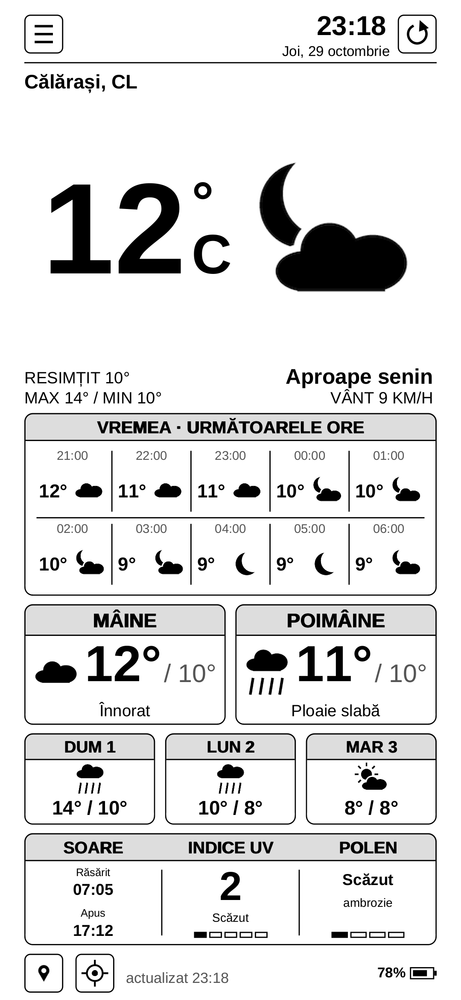
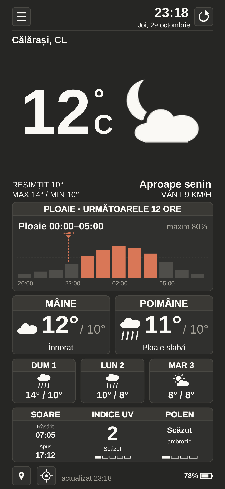
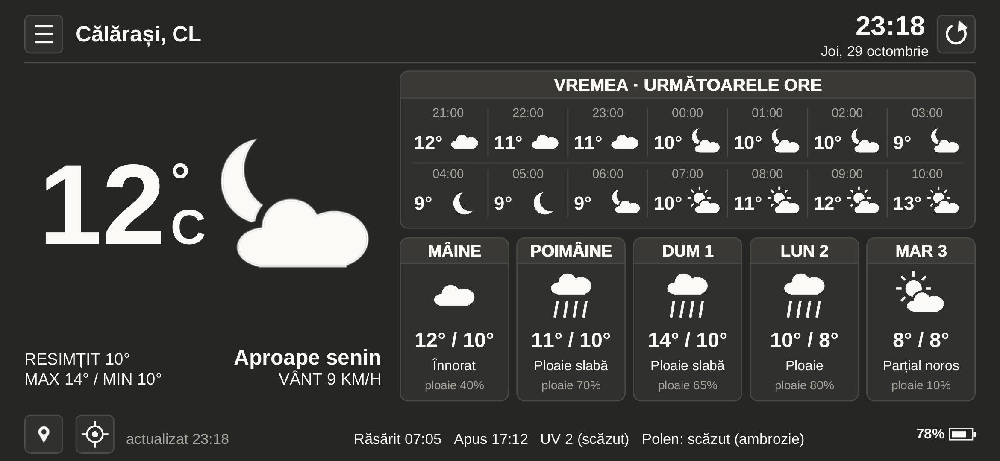

# Meteo Alarm Android

**Latest version:** see [Releases](https://github.com/viorelrb-alt/meteo-alarm-android/releases/latest) (test versions).

The [Meteo Alarm Kindle](https://github.com/viorelrb-alt/meteo-alarm-kindle-ro) screen ported to an Android phone, kept black and white like the
Kindle and laid out for a tall screen (made for a Samsung Galaxy A54, 1080x2340). Same data as the
Kindle: Open-Meteo (DWD ICON) forecast, MeteoAlarm warnings for the county, pollen, sun and UV.

<p>
  
  
</p>



*PC previews drawn by the same code with sample data (`./build.sh preview [dark] [land] [dry] [warn]`).*

## What it does

- Portrait and landscape: it turns with the phone (unless auto-rotate is off). Landscape has
  the weather now on the left; the next hours (or the rain chart) and the five days on the right;
  sun, UV and pollen in the status line.
- Full screen clock and weather, screen kept on (a ☰ menu option lets it sleep).
- Clock, date, city with county code, up to two MeteoAlarm warnings (yellow, orange, red).
- Big temperature and icon, feels like, high/low, wind.
- Rain and snow chart for the next 12 hours with the "now" marker when rain or snow is due;
  otherwise the next hours as tiles (temperature and icon), as many as the width allows:
  10 in portrait, 14 in landscape on the A54.
- Tomorrow, the day after and three more days; sunrise/sunset, UV index and pollen.
- ☰ menu: refresh, choose town (the 315 towns of `cities.txt`, the last three as favourites),
  °C/°F, 12h/24h, Romanian/English, keep the screen on, theme.
- Themes: light (Kindle black and white), dark (the Claude app's colours: warm charcoal, ivory
  text, terracotta for rain and "now"; warning codes in muted yellow, orange and red), or
  automatic, following the phone's dark mode (the default).
- Location: the app asks for location access, finds the town at start and every hour (Android's
  location providers, then the phone's geocoder or OpenStreetMap Nominatim), and shows the
  weather for the exact position. A town missing from `cities.txt` is added to a list kept on the
  phone. The crosshair button next to the town button locates now; picking a town from the list
  turns automatic location off until the crosshair is tapped again.
- Updates: ☰ › Check for updates looks at the latest GitHub Release of this repository, downloads
  the APK and opens the installer; it also checks once a day at start.
- Weather every 15 minutes while open (hourly at night), cached for offline start.

## Build

No Gradle and no Google SDK download needed; Ubuntu's Android tools are enough:

```sh
sudo apt-get install android-sdk-platform-23 aapt dalvik-exchange zipalign apksigner
./build.sh            # -> build/MeteoAlarmAndroid-v<version>.apk
./build.sh preview    # -> build/preview.png (draws the screen on a PC)
```

Signing: every version must be signed with the same key, or it will not install over the one on
the phone. The key is not in this repository: `KEYSTORE=/path/to/debug.keystore ./build.sh`.

## Releases

Put the signed APK and its notes in `dist/` (`MeteoAlarmAndroid-v<version>.apk`,
`notes-v<version>.md`, the version being `android:versionName` in `AndroidManifest.xml`) and push to
`main`: the Release workflow publishes them as the Release `v<version>`, which the app then offers
as an update.

## Install on the phone

Download the APK from [Releases](https://github.com/viorelrb-alt/meteo-alarm-android/releases/latest) on the phone, open it from **My Files**, and allow **Install unknown apps** for that
app when asked. If Play Protect warns about an unknown developer, choose **Install anyway**.

## Code

- `src/ro/meteoalarm/android/core/`: plain Java, no Android: data (`Weather`, `Warnings`), texts
  and the screen drawing (`Screen`, on a 758-unit wide canvas like the Kindle's).
- `src/ro/meteoalarm/android/`: the Android activity, view and canvas.
- `preview/`: draws `Screen` with Java2D for a PNG preview.
